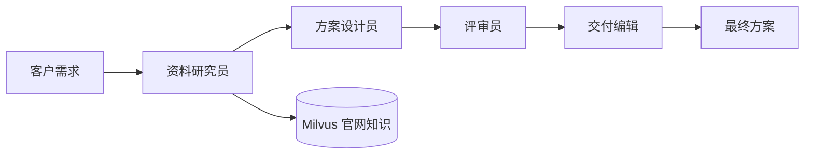

# 多智能体协作示例

官方文档：https://java2ai.com/docs/frameworks/agent-framework/advanced/multi-agent/

## 场景与分工

客户希望建设网络流量感知、恶意行为识别和风险处置闭环，团队需要基于DeepSeek资料提出初步方案，
并检查方案是否有事实依据、是否遗漏需求、是否存在未经证实的承诺。

使用四个独立 ReactAgent，由 SequentialAgent 编排：

| Agent | 职责 | 能看到的输入状态 | 输出状态键 | 工具 |
| --- | --- | --- | --- | --- |
| researcher | 查资料，提取有来源的事实与缺口 | input | research | 只读 Milvus 检索 |
| solution_designer | 根据事实设计初步方案 | input、research | draft | 无 |
| reviewer | 独立核对初稿与原始证据 | input、research、draft | review | 无 |
| editor | 根据评审修订最终方案 | input、research、draft、review | final_proposal | 无 |



## 为什么属于多智能体

每个 Agent 有自己的 name、角色提示、任务指令、工具权限与 outputKey。
框架将输出写入 OverAllState，下一位 Agent 的 instruction 通过 `{research}`、`{draft}`、`{review}`
读取前面的结果。评审员看到方案初稿和原始事实，编辑看到评审结果，因此各节点实际依赖上游交付。

四个 Agent 共用 qwen-plus 模型连接。Agent 是角色、上下文、工具与执行循环的组合，
不要求使用不同模型、不同机器或不同进程。此示例使用确定的顺序编排，不是 LLM 自主路由或并行执行。
更复杂的任务可使用 ParallelAgent 并行处理独立分工、SupervisorAgent 动态调度或 LoopAgent 反复修订。

现有 Demo1/AgentExample/SkillCallDemo 等只有一个 ReactAgent；MCP 客户端与服务端提供工具协议，
服务端本身并不是另一个自主推理 Agent。RagDemo 和标准 ChatClient 示例主要是单模型增强调用。
一个 Agent 使用多个工具、MCP 或 Skill，仍然可以是单智能体。

## 运行

使用 JDK 17，在 IDE 运行 `MultiAgentDemo.main`。
终端输入客户需求，直接回车使用内置场景，输入 exit 退出。
终端显示每个 Agent 开始/完成、接收的状态键、研究员真实工具调用，以及四份中间/最终输出。
完整协作记录写到 `target/multi-agent-report.md`，每次运行覆盖。

Key 按现有示例复制 Demo1，直接写在代码中。复用项目现有依赖，不需要升级版本。
知识检索沿用 RagDemo 和 application.yml：Milvus <your-milvus-host>:19530，
数据库 DEEPSEEK，集合 deepseek_home_knowledge_v1。若没有知识先运行 RagDemo 入库。
此示例只读检索，不重新入库，不需要 MCP Server。每次客户需求构建一个新团队，无跨请求记忆。
四个 Agent 分别调用模型，会比单模型问答消耗更多调用与时间。
方案属于模型建议；仅公司能力事实来自官网知识，代码要求明确区分建议与已证实事实。

项目 pom 排除了 other/**，PowerShell 单独编译运行：

```powershell
$env:JAVA_HOME = 'D:\GreenSoft\java\jdk-17.0.14'
& 'D:\GreenSoft\apache-maven-3.9.11\bin\mvn.cmd' -q dependency:build-classpath '-Dmdep.outputFile=target/multi-agent-classpath.txt'
$multiClasspath = (Get-Content 'target/multi-agent-classpath.txt' -Raw).Trim()
& "$env:JAVA_HOME\bin\javac.exe" -encoding UTF-8 -cp $multiClasspath -d target/multi-agent-classes src/main/java/other/RagDemo.java src/main/java/other/MultiAgentDemo.java
& "$env:JAVA_HOME\bin\java.exe" -Dfile.encoding=UTF-8 -cp "target/multi-agent-classes;src/main/resources;$multiClasspath" other.MultiAgentDemo
```

传入 --verify 执行内置场景并退出；其他参数作为单次客户需求。
每次执行都检查四个 Agent 是否按序完成、上游输入是否存在、四份输出是否非空，以及是否实际检索了知识库。
最终报告中的 URL 必须来自检索工具真实返回的来源集合；缺少来源或生成其他链接会报错，避免把编造的来源当作证据。
这些检查验证编排与数据传递，不代表自动证明模型方案在业务上完全正确。

2026-10-08 已完成真实端到端验证：四个 Agent 顺序执行，研究员调用 Milvus 检索 3 次，
研究结果、初稿、评审意见和最终方案全部返回，来源校验通过，进程正常退出。
执行中仅查询现有知识，Milvus 知识数量保持为 8。
